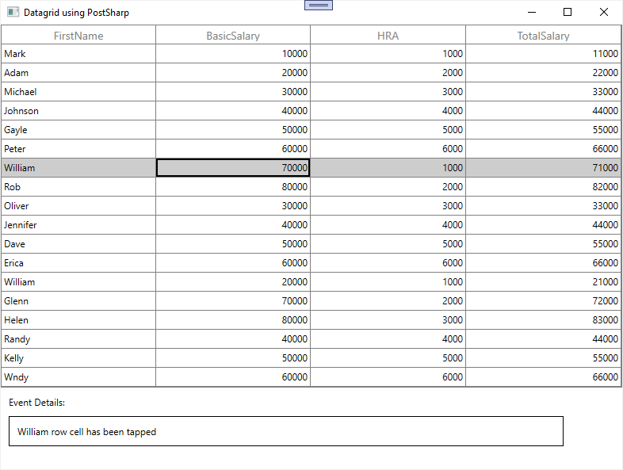

# How to populate Syncfusion WPF controls using PostSharp?

This sample demonstrates how to use [PostSharp](https://www.postsharp.net/) together with Syncfusion WPF controls to eliminate repetitive `INotifyPropertyChanged` boilerplate while keeping a WPF application clean and easy to maintain. The sample binds a collection of business objects to a [Syncfusion WPF DataGrid](https://help.syncfusion.com/wpf/datagrid/getting-started) and shows how PostSharp can automatically generate property change notifications for model classes.

## Overview

In a typical WPF application, each business object that participates in data binding often needs to implement `INotifyPropertyChanged`. This results in repetitive code in every property setter. PostSharp helps reduce that boilerplate by applying the `[NotifyPropertyChanged]` attribute to a class so the notification logic is generated at build time. This keeps the model simple and prevents manual property change handling from cluttering the business layer.

This example includes a data model for employee records and a view model for the grid. The `WPF Data Grid` displays employees with an editable layout, and tapping a cell updates a text area to indicate which employee's row was interacted with.

## Features

- Automatic property change notifications using PostSharp
- Syncfusion WPF Data Grid binding with `ObservableCollection<T>`
- Editable grid cells with automatic column sizing
- Command-based cell interaction handling in the view model
- Example employee data model with computed salary values
- Simple WPF UI demonstrating real-world data binding patterns

## Project structure

- `SyncfusionPostSharp.sln` – solution file for the sample
- `SyncfusionPostSharp/` – main WPF application project
  - `App.xaml` and `App.xaml.cs` – application startup
  - `MainWindow.xaml` and `MainWindow.xaml.cs` – the main UI window
  - `Model/Employee.cs` – employee model with PostSharp attributes
  - `ViewModel/EmployeeViewModel.cs` – view model with collection data and command logic
  - `packages.config` – NuGet package references
- `Images/Output.png` – screenshot of the sample output

## Implementation details

The data model class is decorated with `[NotifyPropertyChanged]`, which allows the properties to notify the UI whenever they change:

```csharp
[NotifyPropertyChanged]
public class Employee
{
    public Employee(string firstName, int basicSalary, int hra)
    {
        this.FirstName = firstName;
        this.BasicSalary = basicSalary;
        this.HRA = hra;
    }

    public string FirstName { get; set; }
    public int BasicSalary { get; set; }
    public int HRA { get; set; }
    public int TotalSalary { get { return BasicSalary + HRA; } }
}
```

The view model also uses `[NotifyPropertyChanged]` and exposes the employee collection and command that responds when a cell is tapped:

```csharp
[NotifyPropertyChanged]
public class EmployeeViewModel
{
    public ObservableCollection<Employee> Employees { get; set; }

    public string EmployeeEventDetail { get; set; }

    [Command(ExecuteMethod = nameof(ExecuteCellTapped), CanExecuteMethod = nameof(CanExecuteCellTapped))]
    public ICommand CellTappedCommand { get; set; }

    private void ExecuteCellTapped(GridCellTappedEventArgs args)
    {
        EmployeeEventDetail = (args.Record as Employee).FirstName + " row cell has been tapped";
    }
}
```

The XAML layout binds the grid to the view model and displays the selected cell information below it:

```xml
<Window.DataContext>
    <local:EmployeeViewModel/>
</Window.DataContext>

<StackPanel>
    <Syncfusion:SfDataGrid ItemsSource="{Binding Employees}" AllowEditing="True" ColumnSizer="Star">
        <i:Interaction.Triggers>
            <i:EventTrigger EventName="CellTapped">
                <i:InvokeCommandAction Command="{Binding CellTappedCommand}" PassEventArgsToCommand="True"/>
            </i:EventTrigger>
        </i:Interaction.Triggers>
    </Syncfusion:SfDataGrid>
    <TextBlock Text="Event Details:"/>
    <TextBlock Text="{Binding EmployeeEventDetail}"/>
</StackPanel>
```

## Requirements

To run this sample, you need:

- Visual Studio 2019 or later
- .NET Framework support for WPF applications
- Syncfusion WPF controls package
- PostSharp package installed in the project
- Access to the sample dependencies from NuGet

## How to run this example

1. Clone the repository to your local machine.
2. Open `SyncfusionPostSharp.sln` in Visual Studio.
3. Restore the required NuGet packages.
4. Ensure the `SyncfusionPostSharp` project is set as the startup project.
5. Build the solution and press `F5` to run the application.

## Output

When the application is launched, the grid loads employee records and allows cell editing. If a cell is tapped, the event detail text updates with the selected employee name, as shown below.



## Blog reference

This sample is based on the blog article:

[How to Get Rid of the INotifyPropertyChanged Boilerplate](https://www.syncfusion.com/blogs/post/how-to-get-rid-of-the-inotifypropertychanged-boilerplate.aspx)

## Related links

- [Syncfusion WPF DataGrid documentation](https://help.syncfusion.com/wpf/datagrid/getting-started)
- [PostSharp documentation on `NotifyPropertyChanged`](https://doc.postsharp.net/inotifypropertychanged-add)
- [Syncfusion UI for WPF](https://www.syncfusion.com/wpf-ui-controls)

This sample is a practical example of how PostSharp can simplify WPF application development by removing repetitive view-model and model boilerplate while preserving the benefits of data binding and property change notifications. It is especially useful for scenarios where data-heavy grids and forms need to stay maintainable without writing a large amount of repetitive notification code.
